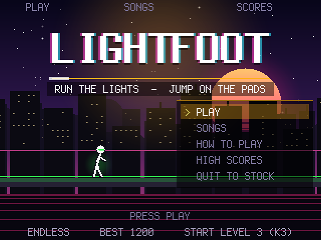
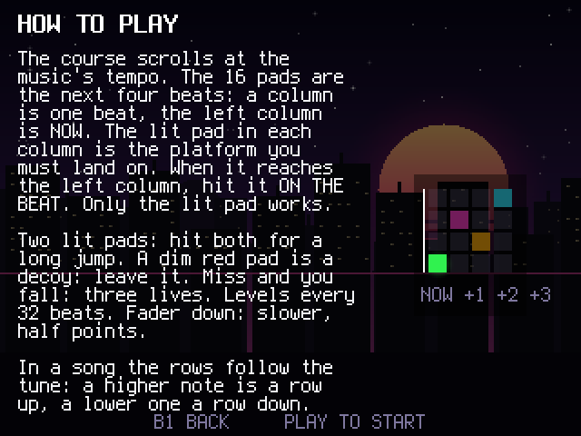
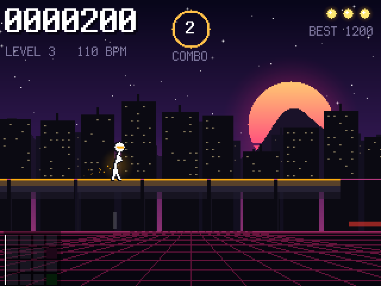
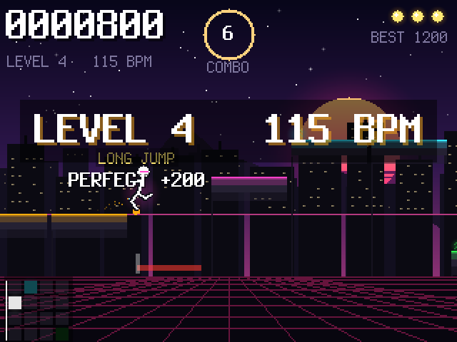
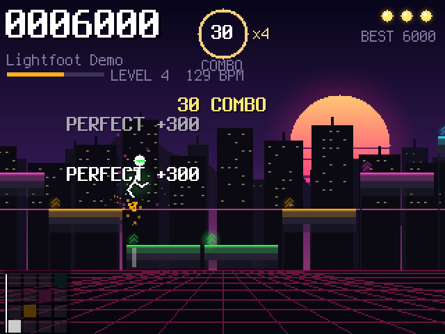

# Lightfoot manual

## Introduction

Lightfoot is a rhythm platformer for the MPC Sample. A runner races through a
neon city that scrolls at the music's tempo, and the sixteen pads tell you
where the next four platforms are. You jump by hitting the lit pad on the
beat. That is the whole game, and it gets fast.

Runs from the SD card. Nothing on the device is modified: remove the card and
the MPC is stock again. Firmware 1.3.0.12 only.

> **Tip:** The left column of pads is always "now". Watch the lit pad slide towards it, and hit it when TAP TEMPO flashes.

## Install

1. Unzip `lightfoot.zip` and copy the `autorun` folder to the root of an exFAT microSD card, or add the zip to mpc-boot-thingy.
2. Power the MPC off, insert the card, power on. The title appears after the splash.
3. To go back to stock: **Quit to stock** on the title screen, **SHIFT** + **STOP** twice from anywhere, or power on without the card.

## How to play

1. Press **PLAY**. Four beats count in, then the course begins.
2. Each pad column is one step ahead, a beat on the endless course and half a beat in a song with off-beat notes: the left column is now, the right column is three steps away. The lit pad in a column is the platform you must land on; its row is the platform's height, top row highest.
3. When a lit pad reaches the left column, hit it **on the beat**. On time is PERFECT, close is GOOD. Only the lit pad counts: an unlit pad does nothing, a lit pad in a later column is EARLY and breaks your combo.
4. Miss the beat and the runner falls. You lose a life and the combo, and the course carries on from the next platform. Three lives.
5. Every 32 beats the level rises: faster, more jumps, then twins and decoys.

**Twins.** Two pads lit in one column are a long jump over a gap. Hit both together, or the second right after the first. Worth double.

**Decoys.** From level 5 a dim red pad appears next to the lit one. Hit it and you slip: the combo goes, a life does not.

**Combo and multiplier.** Every hit adds to the combo; the multiplier rises by one for every ten. A miss or slip resets it.

## Your own songs

A Standard MIDI File (`.mid`) can be the music and the course. Put files in
`Lightfoot/Songs/` on the card, or browse to one anywhere on the card or the
MPC's internal storage. A demo tune is written there the first time the game
runs.

Press **SONGS** on the title (**B2**, or the wheel). The list shows the
endless course first, then every song in the folder, then **Browse the
card**. Press the wheel or **PLAY** on a song to start it straight away.

What the game does with a file:

- The tempo map and time signature come from the file. The course runs at
  the song's tempo, speeding up and slowing down where the file does.
- The tune is the channel with the most notes above the bass register. Its
  notes become the jumps, so you play the rhythm as written: a song with
  notes between the beats runs in half-beat steps, with each pad column half
  a beat. The rows follow the shape of the tune rather than its pitch: a
  note higher than the last is one row up, a lower one a row down, the same
  note stays. Before a run of four or more rises or falls the course moves
  to the far end, by more than one row if it must, so the whole run can be
  played across the height. A chord becomes a long jump when the step after
  it is free. Notes closer together than half a beat are thinned.
- Levels rise every 32 beats as on the endless course. Each level plays the
  song 5% faster, and from level 5 decoys appear. **K3** sets the start level
  for songs too.
- You play the tune, from a chart that is a simplified melody. Levels 1
  and 2 ask for the strong beats only, levels 3 and 4 for every beat, level
  5 upwards for every note; a held note is always in the chart. The rest of
  the tune plays itself along with the band, and the whole melody follows
  your hands: a hit sounds its note, late and it comes in late, miss and the
  tune drops out until your next hit. A PERFECT plays the note a little
  harder. Start at a higher level with **K3** for the full chart from bar one.
- Every other channel is played by the built-in synth: drums on channel 10
  onto the kit, low notes as bass, long notes as pads, the rest as plucks. A
  file without drums gets a kick and hats underneath so the beat stays
  audible.
- Four beats count in, then the song starts at its first bar. Leading
  silence in the file is skipped. The run ends with **SONG CLEAR** when the
  song does, and the score goes on the table with the song's name.

> **Tip:** Files with one clear melody line and a steady beat make the best courses. Sixteenth-note runs are thinned to eighths.

## Controls

| Control | Action |
|---|---|
| Pads 1–16 | The course. Hit the lit pad in the left column on the beat. |
| **PLAY** | Start a run from the title, or pause and resume one. |
| **STOP** | Pause a run. From the pause screen, quit the run. |
| **SHIFT** + **STOP** | Twice within three seconds: quit to stock, from anywhere. |
| Wheel | Move through the title menu; press to choose. |
| **B1** / **B2** / **B3** | On the title: Play, Songs, High scores. In a menu, B1 goes back. |
| **K1** | Repaint the night: the whole palette follows the hue. |
| **K2** | Open the music's filter. |
| **K3** | Start level, 1 to 8, chosen on the title. Practise the fast end. |
| **Fader** | Assist: down slows the course by up to a quarter and halves the points. |
| **MAIN VOLUME** | Output level. |

## What the panel shows

| Light | Meaning |
|---|---|
| Pads | The next four beats. The left column pulses; later columns are dimmer. White flash on a hit, red on a miss. |
| **TAP TEMPO** | The metronome: bright on every beat. |
| Level meters | Left is combo heat, right is the kick. |
| Track LEDs A–H | The level. |
| **MUTE** to **SEQ RECORD** | Chase upwards when a level begins. |
| **PLAY** | Bright during a run. |

## Scores

A run that ends on the game-over screen goes on the table if it is in the
top eight. The table is `Lightfoot/scores.json` on the card, with the level
reached, the best combo and the date. The title shows your best.

## Troubleshooting

| You see | Why | What to do |
|---|---|---|
| A song will not load | Not a format 0 or 1 MIDI file, or no notes in it | The log on the card says which; SMPTE-timed files are not supported |
| Hits feel late or early | The codec adds about 20 ms before you hear the beat; the game allows for it, but headphones and speakers differ | Use the TAP TEMPO flash and the beat line under the runner as the reference, not the sound alone |
| No sound | The output did not open | Check `autorun/user/lightfoot.log` on the card for the line beginning `alsa:` |
| Pads trigger on their own when a knob is turned | A firm knob twist can shake a light tap out of the pads | Turn the knobs between runs; the title screen is the place for K1 and K3 |

Not affiliated with inMusic Brands or Akai Professional. MPC and MPC Sample are their trademarks.
