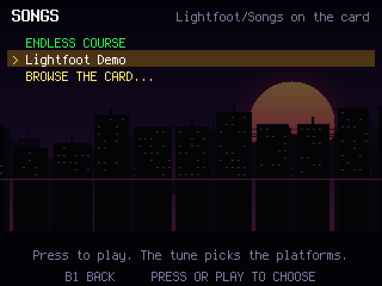
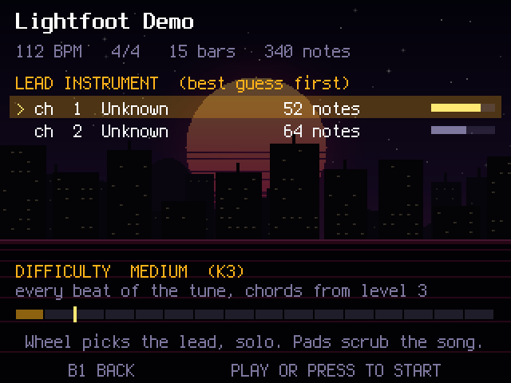
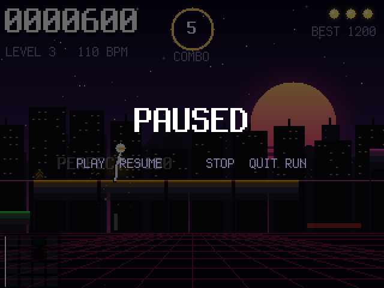
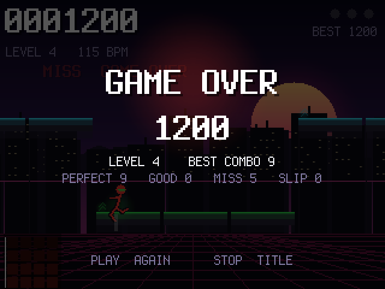
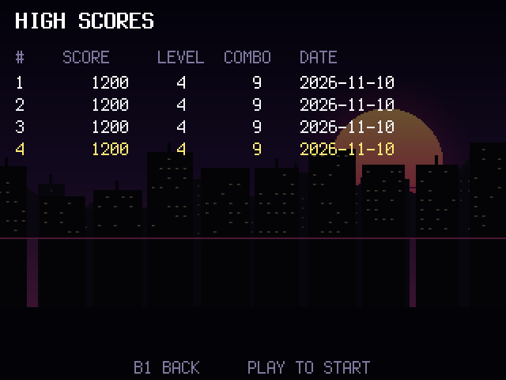

# Lightfoot manual

## Introduction

Lightfoot is a rhythm game for the MPC Sample in the Guitar Hero mould.
Gems come down a four-lane highway at the music's tempo, and the sixteen
pads are the same highway: each row is a step ahead, the bottom row is the
strike line, and the lit pad in a row shows the lane. When a gem reaches
the line you hit a pad in its lane on the beat. Play a song and the gems are
its melody, which only sounds when you hit them.

Runs from the SD card. Nothing on the device is modified: remove the card and
the MPC is stock again. Firmware 1.3.0.12 only.

> **Tip:** Watch the bottom row of pads and TAP TEMPO. The gem is due when its pad reaches the bottom row and TAP TEMPO flashes.

## Install

1. Unzip `lightfoot.zip` and copy the `autorun` folder to the root of an exFAT microSD card, or add the zip to mpc-boot-thingy.
2. Power the MPC off, insert the card, power on. The title appears after the splash.
3. To go back to stock: **Quit to stock** on the title screen, **SHIFT** + **STOP** twice from anywhere, or power on without the card.

## How to play

1. Pick a difficulty with **K3**, then press **PLAY**. Four beats count in, then the gems start down the highway.
2. The lanes are green, red, yellow and blue, left to right, and the four pad columns are the same four lanes. A gem's row on the pads is how far away it is: the top row is three steps ahead, the bottom row is now.
3. When a gem reaches the strike line, hit any pad in its column **on the beat**. On time is PERFECT, close is GOOD. Hitting a lane whose gem is still further up the highway is EARLY and breaks your streak. A lane with nothing coming does nothing.
4. Two gems joined by a bar are a chord: hit both lanes together, or the second right after the first. Worth double.
5. A dark gem with a cross is a decoy. Hit it and you slip: the streak goes and the rock meter dips.
6. Misses drain the rock meter on the left; hits fill it. When it empties you fail. Hits also build a streak, and the multiplier rises by one for every ten.
7. Every 32 beats the level rises: faster, busier, and on a song the melody fills in.

## Difficulties

**K3** sets the difficulty, shown on the title and the song page and kept between runs.

| Difficulty | Endless course | Songs |
|---|---|---|
| **Easy** | Starts at level 1 | The strong beats of the tune only. No chords, no decoys. |
| **Medium** | Starts at level 3 | Every beat of the tune. Chords from level 3. |
| **Hard** | Starts at level 5 | Every note. Decoys from level 5. The rock meter drains faster. |
| **Expert** | Starts at level 7 | Every note, chords and decoys from bar one, and the song plays 10% faster. |

Levels still rise every 32 beats on every difficulty, so an Easy run ends up asking for more than it began with.

## Your own songs

A Standard MIDI File (`.mid`) can be the music and the course. Put files in
`Lightfoot/Songs/` on the card, or browse to one anywhere on the card or the
MPC's internal storage. A demo tune is written there the first time the game
runs.

Press **SONGS** on the title (**B2**, or the wheel). The list shows the
endless course first, then every song in the folder, then **Browse the
card**. Choosing a song opens its page: tempo, length, and the **lead
instrument**, the line you will play. The game guesses it from the file,
preferring a single-note line in the singing register on a melody
instrument that is there for most of the song, and lists the other channels
in order. While the page is open the song plays with the chosen line on its
own, so you hear what you would be playing; turn the wheel and the next
channel takes over from the same place. If it picked a guitar riff instead
of the vocal line, turn the wheel to the right one; the choice is remembered
for that song. The pads jump through the song, pad 1 the start and pad 16
the last sixteenth, and the bar under the list shows where you are. **PLAY**
or the wheel press starts.

What the game does with a file:

- The tempo map and time signature come from the file. The course runs at
  the song's tempo, speeding up and slowing down where the file does.
- The lead instrument's notes become the gems, so you play the rhythm as
  written: a song with notes between the beats runs in half-beat steps, with
  each pad row half a beat. The lanes follow the shape of the tune rather
  than its pitch: a note higher than the last moves one lane to the right, a
  lower one a lane to the left, the same note stays. Before a run of four or
  more rises or falls the chart moves to the far side, by more than one lane
  if it must, so the whole run can be played across the four lanes. A chord
  on a free step is two gems joined. Notes closer together than half a beat
  are thinned.
- Levels rise every 32 beats as on the endless course, and each level plays
  the song 5% faster.
- You play the tune, from a chart that is a simplified melody. The
  difficulty sets the floor (strong beats, every beat, or every note) and
  the levels fill it in from there; a held note is always in the chart and
  shows a tail on the highway. The rest of the tune plays itself along with
  the band, and the whole melody follows your hands: a hit sounds its note,
  late and it comes in late, miss and the tune drops out until your next
  hit. A PERFECT plays the note a little harder, and nothing else: the tune
  is the only sound a hit makes.
- Every other channel is played by the built-in synth: drums on channel 10
  onto the kit, low notes as bass, long notes as pads, the rest as plucks. A
  file without drums gets a kick and hats underneath so the beat stays
  audible.
- Four beats count in, then the song starts at its first bar. Leading
  silence in the file is skipped. The run ends with **SONG CLEAR** when the
  song does, and the score goes on the table with the song's name.

> **Tip:** Files with one clear melody line and a steady beat make the best courses. Sixteenth-note runs are thinned to eighths.

## Controls

| Control | Action |
|---|---|
| Pads 1–16 | The highway. Hit a pad in the gem's lane when it reaches the bottom row. On a song's page, jump to that sixteenth of the song. |
| **PLAY** | Start a run from the title, or pause and resume one. |
| **STOP** | Pause a run. From the pause screen, quit the run. |
| **SHIFT** + **STOP** | Twice within three seconds: quit to stock, from anywhere. |
| Wheel | Move through the title menu; press to choose. |
| **B1** / **B2** / **B3** | On the title: Play, Songs, High scores. In a menu, B1 goes back. |
| **K1** | Repaint the night: the whole palette follows the hue. |
| **K2** | Open the music's filter. |
| **K3** | Difficulty: Easy, Medium, Hard, Expert. Chosen on the title or the song page. |
| **Fader** | Assist: down slows the course by up to a quarter and halves the points. |
| **MAIN VOLUME** | Output level. |

## What the panel shows

| Light | Meaning |
|---|---|
| Pads | The next four steps, top to bottom. The bottom row pulses; higher rows are dimmer. White flash on a hit, red down the lane on a miss. |
| **TAP TEMPO** | The metronome: bright on every beat. |
| Level meters | Left is the rock meter, right is the kick. |
| Track LEDs A–H | The level. |
| **MUTE** to **SEQ RECORD** | Chase upwards when a level begins. |
| **PLAY** | Bright during a run. |

## Scores

A run that fails or clears a song goes on the table if it is in the top
eight. The table is `Lightfoot/scores.json` on the card, with the
difficulty, the level reached, the best streak, the song and the date. The
title shows your best.

## Troubleshooting

| You see | Why | What to do |
|---|---|---|
| A song will not load | Not a format 0 or 1 MIDI file, or no notes in it | The log on the card says which; SMPTE-timed files are not supported |
| Hits feel late or early | The codec adds about 20 ms before you hear the beat; the game allows for it, but headphones and speakers differ | Use the TAP TEMPO flash and the bottom pad row as the reference, not the sound alone |
| No sound | The output did not open | Check `autorun/user/lightfoot.log` on the card for the line beginning `alsa:` |
| Pads trigger on their own when a knob is turned | A firm knob twist can shake a light tap out of the pads | Turn the knobs between runs; the title screen is the place for K1 and K3 |

Not affiliated with inMusic Brands or Akai Professional. MPC and MPC Sample are their trademarks.
