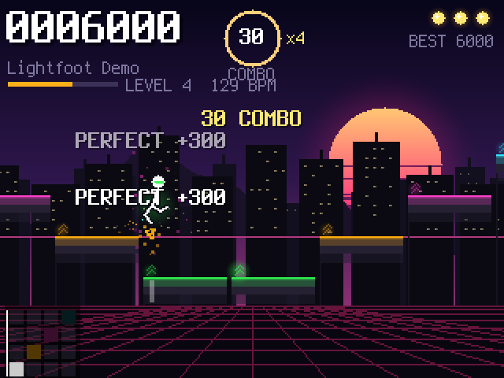
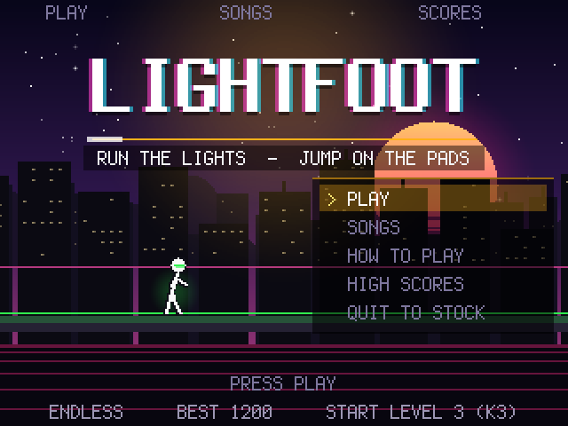
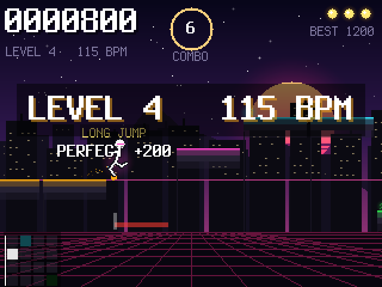
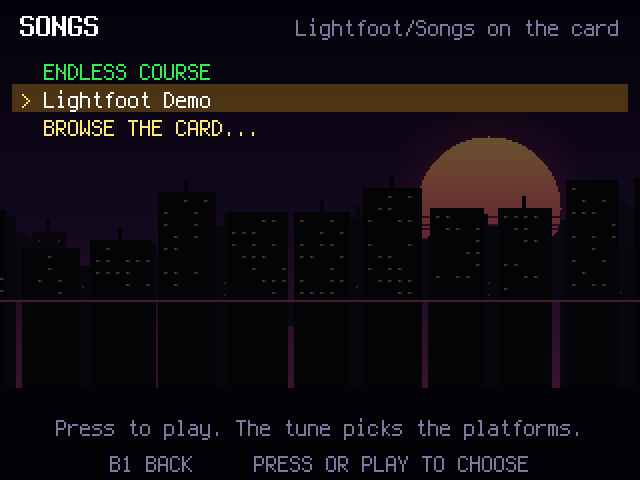
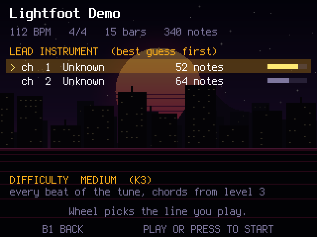
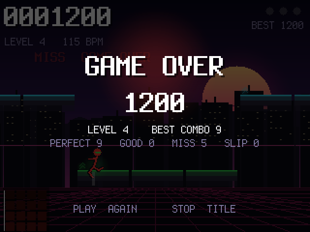
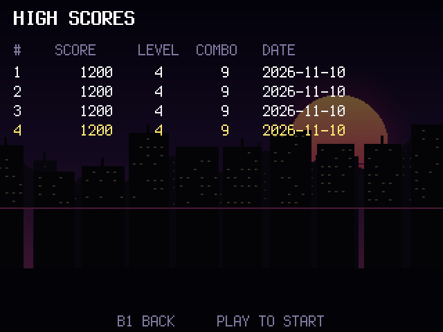

# Lightfoot

A rhythm game for the Akai MPC Sample in the Guitar Hero mould, played on
the pads.



Gems come down a four-lane highway at the music's tempo, and the sixteen
pads are the same highway: each column is a lane, each row is a step ahead,
the bottom row is the strike line. When a gem reaches the line you hit a pad
in its lane on the beat. On time is PERFECT, close is GOOD, early breaks
your streak. Two gems joined by a bar are a chord, hit both lanes. A dark
crossed gem is a decoy, leave it. Misses drain the rock meter and hits fill
it; empty and you fail. Every ten hits in a row raise the multiplier, every
32 beats raise the level, and K3 picks Easy to Expert. Scores are kept on
the card.

Drop a Standard MIDI File into `Lightfoot/Songs/` on the card and it becomes
the music and the chart: the game picks the lead instrument (the wheel can
overrule it), the lead's notes become the gems, the lanes follow the shape
of the tune, the file's tempo drives the highway, and the melody only sounds
when you hit it. The run ends with SONG CLEAR. A demo tune is written there
on first run.

Everything is synthesised on the device: the music, the effects, the night
skyline. The panel plays along: the pads are the highway, TAP TEMPO is the
metronome, the level meters show the rock meter and the kick, the track LEDs
the level, the right-hand buttons chase on a level-up, K1 repaints the night,
K2 opens the filter, K3 picks the difficulty, the fader is an assist.

Runs from the SD card like any autorun app. Nothing on the device is
modified. Firmware 1.3.0.12.

## Screens

<table>
<tr>
<td></td>
<td></td>
</tr>
<tr>
<td align="center">Title</td>
<td align="center">Endless, level 4</td>
</tr>
<tr>
<td></td>
<td></td>
</tr>
<tr>
<td align="center">Songs on the card</td>
<td align="center">A song's page: pick the lead</td>
</tr>
<tr>
<td></td>
<td></td>
</tr>
<tr>
<td align="center">Game over</td>
<td align="center">High scores</td>
</tr>
</table>

The screenshots are taken by the simulator itself: `make shots` renders every
screen headlessly into `build/shots/`, and `make screens` copies the ones the
README and manual use into `docs/screens/`.

- [MANUAL.md](MANUAL.md) is how to play; [Lightfoot-Manual.pdf](Lightfoot-Manual.pdf) is generated from it and ships in the package.
- [PLAN.md](PLAN.md) has the design and what is next.

## Build

Requirements: `zig` (cross-compiler), `python3`, SDL2 (`brew install sdl2`)
for the Mac simulator, `pandoc` and `typst` (`brew install pandoc typst`) for the PDF.

```sh
git submodule update --init --recursive
make sim          # Mac simulator: build/sim/lightfoot-sim (make run starts it)
make shots        # headless screenshots of every screen into build/shots/
make test         # unit tests + shots
make device       # static aarch64 binary: build/device/lightfoot
make manual       # MANUAL.md -> Lightfoot-Manual.pdf
make package      # SD autorun package: build/pkg/lightfoot.zip
make hooks        # git hook: rebuilds the PDF whenever MANUAL.md is committed
```

Simulator keys: Space PLAY, S STOP, Up/Down or the mouse wheel for the data
wheel, Return for the wheel press, F1–F3 for B1–B3, Left Shift for SHIFT, and
the pads on Z X C V / A S D F / Q W E R / 1 2 3 4 (bottom row to top row).

## Install on the device

1. Unzip `lightfoot.zip`. Copy the `autorun` folder to the root of an exFAT
   microSD card, or add the zip to mpc-boot-thingy with `setup.sh --add`.
2. Power the MPC off, insert the card, power on.
3. To return to stock: Quit to stock on the title screen, or SHIFT + STOP
   twice, or power on without the card.

## Layout

```
Sources/
  Game/       rules, judging, scoring, course generation, drawing, scores
  Audio/      the synth: music, effects, and the beat clock
  Shared/     canvas, input frame, JSON, paths
  Platform/   Host (SDL2 simulator, screenshots) and Device (DRM/panel via the toolkit, tinyalsa)
Tests/        unit tests (make test)
deps/         submodules: mpc-ui-toolkit, tinyalsa
tools/        package.sh, build-manual.py, check-manual.py, hooks/
```

Not affiliated with inMusic Brands or Akai Professional. No Akai code or
firmware is in this repository.
